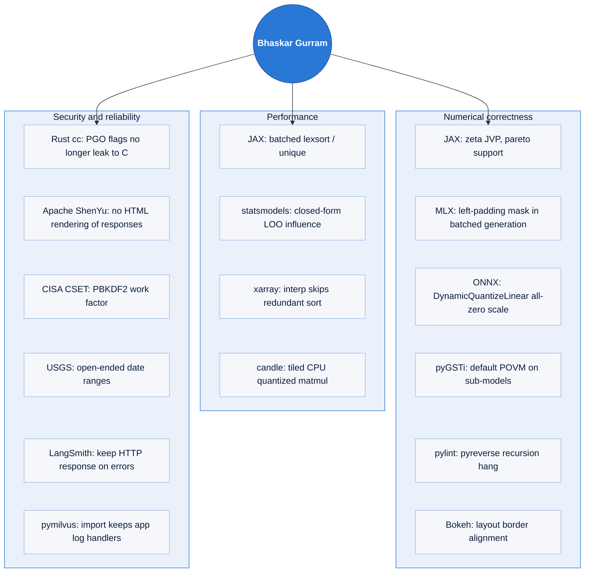

I work on the performance and numerical correctness of scientific and ML software. Most of my open-source work is algorithmic speedups and correctness fixes in libraries that other people build on: Google JAX, statsmodels, xarray, Hugging Face candle, Apple MLX, the Rust `cc` crate, Apache ShenYu, ONNX, and tools run by CISA, USGS and Sandia National Laboratories.

M.S. in Computer Science, University of Cincinnati. AI Engineer at Zasti Inc. (Ashburn, VA).

---

## Where my code runs

---

## Speedups that shipped

<picture>
  <source media="(prefers-color-scheme: dark)" srcset="https://raw.githubusercontent.com/bhaskargurram-ai/bhaskargurram-ai/main/assets/speedups-dark.svg">
  
</picture>

Each bar is a change that was reviewed and merged by the project's maintainers. Timings are from the pull requests.

---

## Merged upstream contributions

| Project | Contribution | Result |
|---|---|---|
| **Google JAX** | [Batched `lexsort` / `unique(axis=...)`](https://github.com/jax-ml/jax/pull/41186): new `batch_size` keyword, designed with a core maintainer over six review rounds | Compile time no longer grows with the number of keys: `jnp.unique` 15.5 s → 0.28 s; `lexsort` on 100 keys 162 s → 0.22 s |
| **statsmodels** | [Closed-form leave-one-out influence measures](https://github.com/statsmodels/statsmodels/pull/10367) (`dfbetas`, `dffits`, `cov_ratio`, studentized residuals); closes maintainer issue #9009 | 35 s → 2.7 ms at n = 10,000; matches R's `influence.measures` to 12 decimals |
| **xarray** | [`interp` skips `sortby` on already-sorted coordinates](https://github.com/pydata/xarray/pull/11658) | Vectorized interp 164 ms → 2.9 ms |
| **Hugging Face candle** | [Row tiling in the CPU quantized matmul for prefill](https://github.com/huggingface/candle/pull/4003) | About 1.45x faster prefill for Q4K / Q8_0; outputs bit-identical |
| **Rust `cc` crate** (rust-lang/cc-rs) | [Stop forwarding `-Cprofile-generate`/`-Cprofile-use` to the C compiler](https://github.com/rust-lang/cc-rs/pull/2003); fixes #1986 | PGO builds no longer segfault when the C compiler's LLVM differs from rustc's (the cause behind rust-lang/rust#163640); shipped in cc 1.8.0 the same day |
| **Mozilla sccache** | [Handle MSVC `/Tc` and `/Tp` input arguments](https://github.com/mozilla/sccache/pull/2904); fixes #2062 | Windows Rust builds using sccache broke once cc 1.5 started passing `-Tp <file>`; projects such as rattler-build pinned cc 1.4.7 to work around it |
| **cargo-binstall** | [`--dns` option to pick the DNS resolver](https://github.com/cargo-bins/cargo-binstall/pull/2709) | Users behind VPNs or NSS-only containers can switch from the built-in hickory-dns to the system resolver |
| **fsspec** (filesystem layer under pandas, xarray, Dask, Hugging Face) | [`callback=` for download progress on caching filesystems](https://github.com/fsspec/filesystem_spec/pull/2272); closes #1623 | Progress reporting for multi-GB cached downloads, requested by NVIDIA's earth2studio team; merged by the lead maintainer |
| **deepset Haystack** | [Remove the unused `Sockets.__getattribute__` override](https://github.com/deepset-ai/haystack/pull/12966) | The override looked up the wrong attribute name and was never reached; removed with type-checked tests after three review rounds |
| **Bokeh** | [Row/Column layout reserves room for aligned borders](https://github.com/bokeh/bokeh/pull/15487) (BokehJS) | Fixes cropped axes and legends; milestone 4.0, backported |
| **Apple MLX (mlx-lm)** | [Left-padding mask in batched generation](https://github.com/ml-explore/mlx-lm/pull/1925) | Fixes wrong logits for left-padded batches in two model families |
| **Google JAX** | [`betainc` converges per element](https://github.com/jax-ml/jax/pull/41440); fixes #28547 | The continued fraction no longer runs to the 200/600-iteration cap for the whole batch (24/43 iterations on the issue's input), and each result no longer depends on the rest of the batch |
| **Google JAX** | [`zeta` JVP rule](https://github.com/jax-ml/jax/pull/41017), [`pareto` support boundary](https://github.com/jax-ml/jax/pull/41015) | Correct values and gradients outside the domain and at the support edge |
| **ONNX** (Linux Foundation AI) | [Define `DynamicQuantizeLinear` scale for all-zero inputs](https://github.com/onnx/onnx/pull/8494) | Spec and reference fix: all-zero inputs no longer give a zero scale (NaN downstream); now matches ONNX Runtime |
| **Apache ShenYu** (Apache Software Foundation) | [Render non-JSON API debug responses as plain text](https://github.com/apache/shenyu-dashboard/pull/708); fixes security issue #614 | The admin console no longer renders upstream response bodies as HTML; merged by a ShenYu PMC member |
| **pylint** | [Fix pyreverse hang/RecursionError with `--all-associated`](https://github.com/pylint-dev/pylint/pull/11620); closes #3602 | Class diagrams of code that rebuilds classes on each inference no longer hang or crash; merged by the pylint maintainer and backported to 4.1.x |
| **CISA CSET** (US DHS) | [Raise the PBKDF2 work factor to OWASP guidance](https://github.com/cisagov/cset/pull/5611) | Password-hash hardening in CISA's Cyber Security Evaluation Tool |
| **NIST macOS Security Compliance Project** (US Dept. of Commerce) | [Show full help for `--help` and subcommand `--help`](https://github.com/usnistgov/macos_security/pull/841); fixes #838 | The `mscp` CLI's subcommand help was swallowed by the logging-flag parser; now each subcommand prints its real options |
| **USGS dataretrieval** (US DOI) | [Open-ended (`..`) date ranges in the OGC client](https://github.com/DOI-USGS/dataretrieval-python/pull/440), [date/datetime/Timestamp arguments](https://github.com/DOI-USGS/dataretrieval-python/pull/442), [`start/end` interval strings](https://github.com/DOI-USGS/dataretrieval-python/pull/443) | Fixes silently unfiltered results and HTTP 400s in the official USGS water-data client |
| **Sandia National Laboratories pyGSTi** | [Default POVM for circuits on a subset of a model's qubits](https://github.com/sandialabs/pyGSTi/pull/932); fixes #721, a 0.11 release blocker | Circuits on part of a multi-qubit model no longer fail with "Missing POVM"; merged by a Sandia maintainer |
| **Microsoft Olive** | [Declare `requests` as an install dependency](https://github.com/microsoft/Olive/pull/2693) | Fixes `import olive` failing after a fresh install; also hit by Microsoft's olive-recipes |
| **LangSmith SDK** | [Keep the HTTP response on `raise_for_status_with_text` errors](https://github.com/langchain-ai/langsmith-sdk/pull/3597) | Shipped in v0.14.2 |
| **Milvus pymilvus** (LF AI & Data) | [Stop closing application logging handlers on import](https://github.com/milvus-io/pymilvus/pull/3814) and [stop bulk_writer from configuring the root logger](https://github.com/milvus-io/pymilvus/pull/3835); fixes #3794 | Importing the SDK no longer silently kills or reconfigures the host application's logging; both backported to 2.6 and 3.0 |
| **ogx** | [Dependency floor for the inline provider](https://github.com/ogx-ai/ogx/pull/6669) | Fixes a user-reported install failure |
| **cartography (CNCF)** | [Handle empty Google Workspace groups](https://github.com/cartography-cncf/cartography/pull/2018) | Fixes a sync crash |

<b>In review right now</b> (30+ open pull requests)

 

Features and fixes under maintainer review as of October 2026, among them:

- **anchore/grype**: [`--fail-on risk=N` thresholds](https://github.com/anchore/grype/pull/3785) and [`--fail-on no-vex-statement`](https://github.com/anchore/grype/pull/3786)
- **anchore/syft**: [Maven scope exclusion for the pom cataloger](https://github.com/anchore/syft/pull/5406)
- **mermaid**: [flowchart `linkStyle` selecting links by label text](https://github.com/mermaid-js/mermaid/pull/8422)
- **cargo-binstall**: [`--dns` / `BINSTALL_DNS` resolver selection](https://github.com/cargo-bins/cargo-binstall/pull/2709)
- **rust-lang/socket2**: [`SO_EXCLUSIVEADDRUSE` getter and setter](https://github.com/rust-lang/socket2/pull/678)
- **plotly.py**: [`custom_data` for `px.histogram`](https://github.com/plotly/plotly.py/pull/5811)
- **fsspec**: [download progress callbacks on caching filesystems](https://github.com/fsspec/filesystem_spec/pull/2272); **gcsfs**: [generation pinning at `open()`](https://github.com/fsspec/gcsfs/pull/1099), [IAM signBlob URL signing](https://github.com/fsspec/gcsfs/pull/1100)
- plus pandas, hickory-dns, Sphinx, LightGBM, Prometheus exporters, gitleaks, git-lfs, modin, tower-http, resvg, ureq and others

---

## Research

- **Valid Per-Field Selective Risk Control for Document Extraction: Three Failure Modes, a Validity Ladder, and When Conditioning Pays.** B. Gurram. [arXiv:2608.14639](https://arxiv.org/abs/2608.14639), 2026. Code: [verifydoc](https://github.com/bhaskargurram-ai/verifydoc).
- **Auditing Automated Evaluation, Error Propagation, and Runtime Mitigation in Tool-Using Language Agents.** B. Gurram. [arXiv:2604.16706](https://arxiv.org/abs/2604.16706), 2026. Code: [agenthallu-bench](https://github.com/bhaskargurram-ai/agenthallu-bench).
- **Agentic systematic literature review: a multi-agent LLM pipeline evaluated on 62 randomized controlled trials across five medical specialties.** Submitted to *Expert Systems with Applications*, 2026. Code: [agentic-slr](https://github.com/bhaskargurram-ai/agentic-slr).
- **M.S. thesis (2024):** EEG-fMRI fusion with temporal convolutional networks for decoding visual stimuli. Accuracy is 84.8% within subject and 81.1% leave-one-subject-out, compared with 65.5% for EEG only and 74.6% for fMRI only. Advisor: Prof. Vikram Ravindra.

## Projects

- [**verifydoc**](https://github.com/bhaskargurram-ai/verifydoc): calibrated per-field confidence and source grounding for document-to-JSON extraction, with accept/review abstention.
- [**unwind**](https://github.com/bhaskargurram-ai/unwind): a reversibility layer for agent tool calls. It is an MCP proxy with a cross-server undo log.
- [**provio**](https://github.com/writ-agent/provio): authorization and provenance for AI agent tool calls.
- [**HARNESS-DB**](https://github.com/harness-db/harness-db): a coded dataset of 1,256 agent harnesses.

---

## Toolbox

Numerics and ML: JAX, NumPy/SciPy, PyTorch, statsmodels, xarray, quantized inference (candle, MLX, GPTQ). Systems: Rust, Go, Python packaging, CI. Agents: MCP, retrieval, evaluation harnesses.

---

## Experience

- **AI Engineer, Zasti Inc.** (2024–present): agentic and retrieval systems for clinical research. Retrieval over 50M+ document embeddings, and 4-bit GPTQ deployment that cut model size by 75%.
- **Graduate Teaching Assistant, University of Cincinnati** (2022–2024): Python, cloud and ML labs for 500+ students.
- **Deep Learning Developer, Technocolabs Softwares** (2021–2022): led a four-person team building medical pattern-recognition models.

## Education

- **M.S. Computer Science**, University of Cincinnati, 2024. GPA 3.95/4.0. Graduate Incentive Award.
- **B.Tech. Computer Science**, SRM Institute of Science and Technology, 2022. GPA 3.98/4.0.
- **MicroMasters in Data Science**, UC San Diego, 2022.

